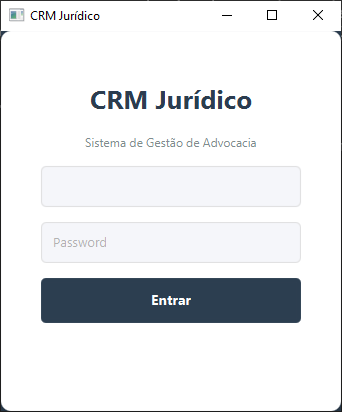
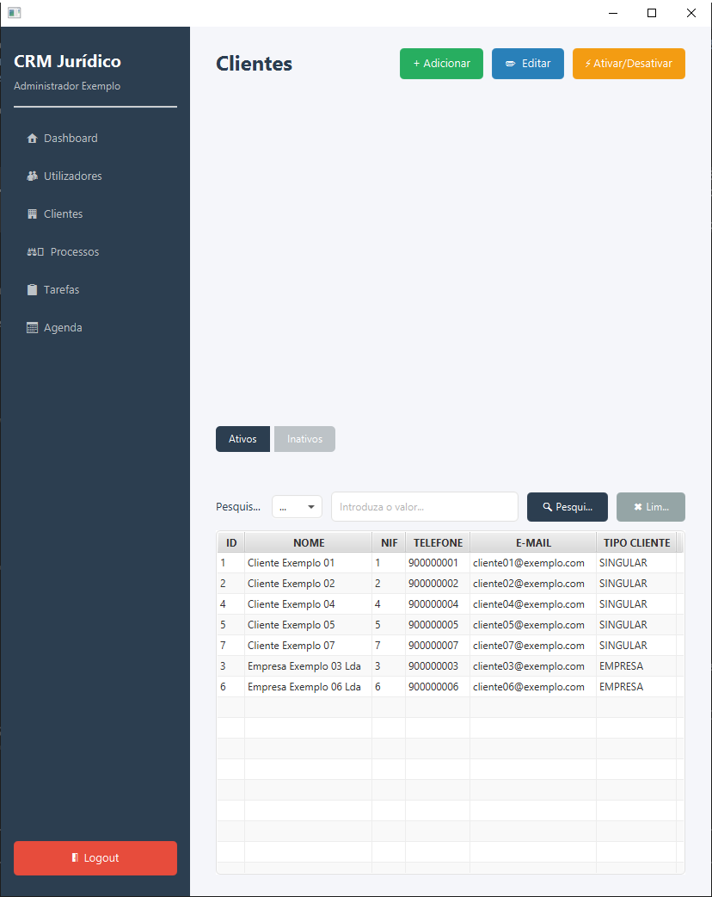
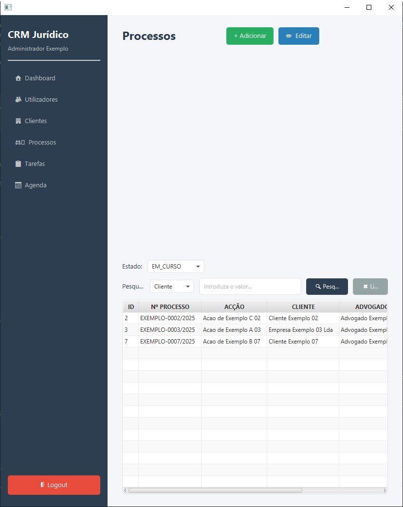

# CRM Jurídico

A desktop CRM for small law firms, written in Java 21 with JavaFX and SQLite. It manages clients, legal cases, tasks and a hearings/deadlines agenda, with role-based access for administrators, lawyers and interns. The UI and data model are in Portuguese (Portugal).

## Screenshots

<!-- Add the image files to the img/ folder; the links below will then render. -->

| Login | Clients | Cases |
|---|---|---|
|  |  |  |

## What it does

- **Authentication** – username/password login (GUI and console). Passwords are stored as SHA-256 hashes; deactivated users cannot log in.
- **Three roles** (`NivelAcesso`): administrator, lawyer and intern. The GUI opens a different screen for each role.
- **Console app (full management)** – a text menu (`viewConsola.Main`) is where records are actually created and changed:
  - Administrators: manage users (create administrators, lawyers and interns; edit; activate/deactivate), plus clients, cases, tasks and agenda.
  - Lawyers and interns: clients, cases, tasks and agenda.
  - Every user can change their own password.
  - On first run it creates the tables and a default administrator if the database is empty.
- **JavaFX GUI (browsing)** – dashboard plus clients, cases, tasks and agenda views with search and status filters, and logout.
  - Administrators can also view users and activate/deactivate users and clients.
  - Lawyers see their own cases, tasks and agenda.
  - The "add" and "edit" buttons in the GUI are placeholders that only show an "under development" message.
- **Data model**
  - **Clients** – name, address, phone, e-mail, NIF (tax number), type (individual or company), active/inactive.
  - **Cases (processos)** – case number, action name, status, distribution/closing dates, linked to a client and a lawyer. Status changes follow allowed transitions (e.g. an archived case cannot be reopened).
  - **Tasks** – title, description, priority, status, due date, linked to a case and a responsible user.
  - **Agenda** – title, location, date/time and status, linked to a case and a user.
- **Persistence** – a local SQLite file (`database/crm.db`), accessed through a DAO layer shared by both front ends.

## Limitations

- No web or multi-user/networked mode: it is a single-machine app on a local SQLite file, with no server, sync or concurrent-access handling.
- No document management (no file upload, templates, or generated contracts/powers of attorney).
- No billing, invoicing, fee tracking or time tracking.
- No integration with court systems (e.g. PJe), e-mail, calendars or notifications/reminders.
- No automated tests (there is no `src/test`).
- No password recovery, user self-registration, or audit log.
- Passwords are hashed with plain, unsalted SHA-256 (`Hash.java`). This is for **educational purposes only** and is not adequate for production; a real deployment needs a salted, slow hash (bcrypt, Argon2, PBKDF2) and a changed default admin password.
- The GUI is mostly read-only: creating and editing records is only possible in the console app (see above), and the GUI does not create the database schema or the initial admin by itself (see Getting started).
- No internationalisation: the interface is Portuguese only.

## Requirements

- JDK 21
- Maven (or the included `mvnw` wrapper)

## Getting started

The app stores everything in `database/crm.db` (a relative path, so always run from the project root). The database file is git-ignored; create it with **one** of the options below.

### Option A – Empty database (console app)

Run `crmjuridico.viewConsola.Main` from your IDE (not yet wired to a Maven goal). It creates the tables and, if the database is empty, a default administrator:

```
username: admin
password: 1234
```

Change this password after the first login.

### Option B – Sample data (`database/seed.sql`)

`database/seed.sql` creates the schema and loads **entirely fictitious** data: 5 users, 8 clients, 8 cases, 10 tasks and 8 agenda entries (e.g. "Cliente Exemplo 01", NIF `000000001`, phone `900000001`, `cliente01@exemplo.com`, case `EXEMPLO-0001/2025`). It must be loaded into a **new, empty** database, because it uses fixed IDs and unique NIFs/usernames.

With the `sqlite3` CLI:

```bash
sqlite3 database/crm.db < database/seed.sql
```

Without it, using Python (3.x):

```bash
python -c "import sqlite3; sqlite3.connect('database/crm.db').executescript(open('database/seed.sql', encoding='utf-8').read())"
```

To start over, delete `database/crm.db` and run the command again.

Demo login: **`admin` / `1234`** (the same documented test password is used for every sample user; their hashes were generated with the project's own `Hash.sha256`):

| Username | Role |
|---|---|
| `admin` | Administrator |
| `advogado01`, `advogado02` | Lawyer |
| `estagiario01` | Intern |
| `estagiario02` | Intern (deactivated – cannot log in) |

> NIFs and phone numbers are stored as integers, so leading zeros are dropped (`000000001` is stored as `1`).

### Build and launch the GUI

```bash
./mvnw clean compile   # build
./mvnw javafx:run         # launch the GUI (login screen)
```

The GUI does not create the schema or the initial admin by itself, so create the database first (Option A or B).

## Project structure

```
src/main/java/crmjuridico/
├── auxiliares/   helpers: SHA-256 hash, console input, console menus
├── controller/   GestaoEscritorio – business logic (singleton)
├── database/     SQLite connection, schema creation, DAOs
├── model/        entities (users, clients, cases, tasks, agenda) and enums
├── viewConsola/  console front end
└── viewGUI/      JavaFX front end (controllers; FXML in src/main/resources)
```

## Tech stack

Java 21 · JavaFX 21 · SQLite (`sqlite-jdbc`) · Maven · JUnit 5 (declared, no tests yet)
